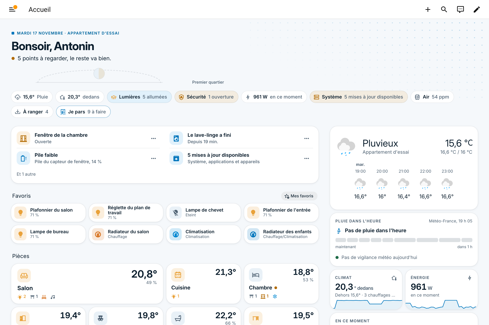

  

<h3 align="center">Installez, c'est prêt.</h3>

**Automatic Dashboard** est un tableau de bord complet pour Home Assistant, qui se construit tout seul à partir de vos pièces, de vos étages et de vos appareils, et suit la maison quand elle change. Rien à configurer, aucune donnée collectée.

- [Le site d'Automatic Dashboard](https://automatic-dashboard.github.io) : la démo et la documentation, en français et en anglais.
- [Le dépôt Automatic-Dashboard/automatic-dashboard](https://github.com/Automatic-Dashboard/automatic-dashboard) : l'intégration et le tableau, sous licence Apache 2.0. Il s'installe depuis le Marketplace de Home Assistant, avec *Ajouter grâce à un lien*.
- [La dernière version](https://github.com/Automatic-Dashboard/automatic-dashboard/releases/latest) et ses notes.

Un projet communautaire et libre, sans but lucratif, initié par Antonin Chenavaz.

*In English: a complete Home Assistant dashboard that builds itself from your areas, floors and devices. Free and community-driven, started by Antonin Chenavaz. [Website](https://automatic-dashboard.github.io/en/) · [Repository](https://github.com/Automatic-Dashboard/automatic-dashboard)*
